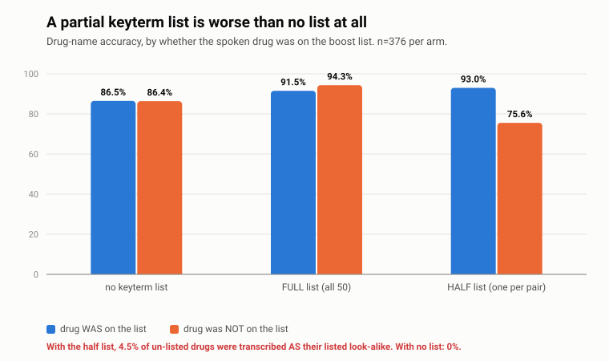
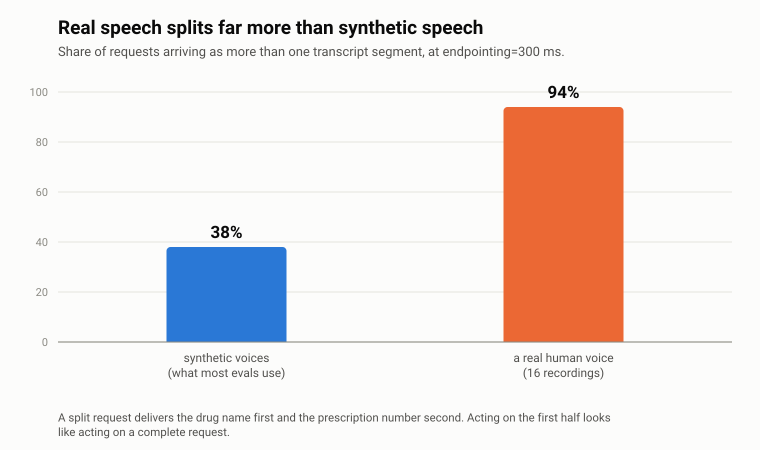

# dgeval — launch-readiness eval harness for Deepgram STT

A pharmacy wants a phone line that takes prescription refill requests. Before
it goes live, somebody has to answer a specific question: **is the speech
recognition good enough, and how would we know if it stopped being good
enough?**

This repo is the apparatus for answering that. It is not a benchmark and not a
demo — it is a gate the customer keeps and runs on every model version, config
change and SDK bump.

### ▶ [Listen to the failures and read the results](https://shivanim99.github.io/deepgram-stt-eval/)

Verdict: **NO-GO**, on two blocking issues. Nova-3 is accurate enough and never
invents words; two things about *how you connect it* would still have caused harm.

<picture>
  <source media="(prefers-color-scheme: dark)" srcset="charts/keyterm-false-trigger-dark.svg">
  
</picture>

**A partial keyterm list is worse than no list.** Boosting one member of each
confusable drug pair -- what happens naturally if a pharmacy lists its best
sellers -- raised accuracy on listed drugs by 6.5 points and dropped their
unlisted partners by 10.8. All eight cross-confusions ran from the unlisted drug
*toward* the listed one, never the reverse, and with no list there were zero. A
recall-only evaluation would have scored that arm as an improvement and shipped
it.

<picture>
  <source media="(prefers-color-scheme: dark)" srcset="charts/fragmentation-dark.svg">
  
</picture>

**Real speech splits far more than synthetic speech.** People pause in the middle
of a seven-digit number, so 94% of real requests arrived in more than one
segment -- 88% even at a one-second endpointing threshold. The first segment
carries the drug name and the second the prescription number, so anything acting
on one final holds half a request that looks whole.

Also measured: **zero fabrication** on all 24 non-speech clips (silence, hold
music, DTMF, dial tone, line noise, crosstalk) in all three configurations, and
**100% exact match** on 188 prescription numbers across every channel condition.

Full results: [FINDINGS.md](FINDINGS.md) in plain language,
[`reports/launch_readiness.md`](reports/launch_readiness.md) technical,
[`reports/MEMO.md`](reports/MEMO.md) customer-facing.

```bash
make setup      # venv + install
make test       # verify the measurement logic -- no API key needed
make corpus     # build the evaluation corpus -- no API key needed
make eval       # transcribe + score      (~$0.25)
make keyterm    # keyterm lift AND cost   (~$0.75)
make sweep      # endpointing curve       (~$0.05, runs at real time)
make report     # render report, exit non-zero if a blocker fails
```

Total API spend for a complete run is **under $2**, against the $200 of free
credit a new Deepgram account receives.

---

## The argument this harness encodes

WER treats every word as equally important. On a pharmacy line it is not.

| transcript | WER | outcome |
|---|---|---|
| "I need a refill on **hydroxyzine**, uh, number 4482109" | 12% | fine — every entity correct |
| "I need a refill on **hydralazine**, prescription 4482109" | 4% | **a dispensing-error pathway** |

The second transcript scores three times better and is the dangerous one.
`hydroxyzine` (an antihistamine) and `hydralazine` (a blood-pressure drug) are
a documented pair on the ISMP Confused Drug Names list. The error is
well-formed, plausible, and invisible to every downstream validation layer —
the output is a real drug that really exists and can really be dispensed.

So this harness reports WER because it is comparable to published numbers, and
makes **entity-level accuracy the thing the launch decision rests on**, with
three severities kept apart:

- `correct` — recognized
- `miss` — mangled into something that is not a drug; a human will catch it
- `cross_confusion` — recognized as a **different real drug** that is a
  documented confusable of the true one; **nothing downstream catches this**

Cross-confusion is tracked as its own metric with its own blocking threshold of
exactly zero.

---

## What gets measured

**Entity accuracy** per drug name, Rx number, date of birth and dose, sliced by
channel condition and by accent, with a cross-confusion matrix naming which
ISMP pairs actually collapsed.

**Degradation across the channel.** Every clip is rendered through clean
16 kHz, 8 kHz G.711 μ-law, μ-law plus pink noise at an exact 10 dB SNR, and
Opus 16 kbps with reverb. A WER measured on clean audio is not a number anyone
can make a launch decision from; the gap between the clean and telephony
columns is the point.

**Fabrication on non-speech.** Synthesized probes for digital silence, room
tone, line noise with mains hum, dial tone, ring tone, DTMF, on-hold music and
crosstalk babble. Any word returned for audio with no speech is an insertion.
Pure digital silence is the easy case and is included as a floor, not as the
test — a real line is never digitally silent.

**Keyterm prompting — the lift and the cost.** Three arms: no boost, all 50
drugs boosted, and only *one member of each confusable pair* boosted. The third
arm is the diagnostic: if boosted-half accuracy rises while the withheld half
drops below baseline, the boost is moving probability between confusable terms
rather than improving acoustic discrimination — and a recall-only evaluation
reports that as an improvement. A separate control threshold catches collateral
WER damage on speech containing no pharmacy vocabulary at all.

**Endpointing — the tradeoff curve, not a number.** `endpointing` is the knob
that sets what a caller feels as dead air, and latency can always be improved
by lowering it. The cost is truncation: the endpoint fires inside a natural
pause and the tail of the utterance is lost — and on this use case the tail is
where the Rx number lives. The deliverable is the curve of endpoint latency
against truncation rate, so the customer picks a point on it. The recommended
setting is deliberately *not* the fastest one; it is the fastest one that does
not lose audio.

---

## Corpus: four tiers

| tier | source | n | role |
|---|---|---|---|
| **A** domain synthetic | templated utterances, macOS `say` across 9 voices / 6 locales | 400 | entity accuracy at volume with exact labels |
| **B** real control | LibriSpeech dev-clean, 1 clip per speaker × 40 speakers | 160 | calibrates the harness itself |
| **C** real domain | own recordings, 16 lines x 4 conditions | 64 | the credibility anchor |
| **D** non-speech | synthesized probes | 24 | fabrication |

**Labels are generated, not annotated.** Utterances are composed from templates
with entity slots, so the ground-truth transcript and the structured entity
labels fall out of the same step. This is what makes a few hundred
exactly-labelled domain clips feasible rather than a week of transcription.

**Tier B is a control, not a data point.** LibriSpeech is studio-read audiobook
speech with no pharmacy vocabulary. Its job is to catch a broken harness: if
Deepgram scores far off its published dev-clean numbers here, the measurement
apparatus is wrong, not the vendor.

**Tier C is the one that matters most.** `make record` walks through a 16-line
script and writes each clip straight to the correct filename; `make qc` then
checks it. Lines are chosen adversarially — both halves of eight ISMP pairs —
because the point of tier C is not coverage but putting a real human voice on
the cases most likely to break.

Getting this tier clean took four passes, and the reasons are worth stating
because none of them were visible without checking:

- The keypress starting each recording was captured up to 10 dB LOUDER than
  the speech. Detecting it afterwards does not work -- once a transient sits
  within ~250 ms of speech, no threshold separates them without risking the
  first phoneme. The recorder counts in and discards a window instead, with
  the countdown deliberately longer than the discard so device-init latency
  cannot shift the cut into the first word.
- Recording over a Continuity iPhone microphone produced runs of exact zeros
  INTERRUPTING SPEECH, periodic at roughly 450 ms, on three clips. A gap like
  that causes a recognition error belonging to the capture path, not the
  recognizer -- a false error in the one tier that anchors the report.
  `make qc` now detects this; the built-in microphone has no wireless link and
  also measured better (33 dB SNR against 23-30 dB).

The general lesson, and the one worth carrying into any evaluation: an eval
harness that has not been audited against its own data will report the
measurement apparatus as a property of the thing being measured.

---

## Methodology notes that change the numbers

**Normalization is explicit.** Deepgram's `smart_format` emits `4482109` where
a caller said "four four eight two one zero nine"; scored naively that is seven
substitutions, and the same system looks excellent or broken depending on a
flag nobody wrote down. One documented normalizer maps both reference and
hypothesis into one space. Every rule is listed in
[`normalize.py`](src/dgeval/metrics/normalize.py) and pinned by
[`tests/test_normalize.py`](tests/test_normalize.py), including the case it
handles imperfectly: a spoken year and a spoken 4-digit cardinal are genuinely
ambiguous in English. That residual ambiguity is a reason to treat WER as the
blunt metric and entity parsing — which is exact — as the decisive one.

**WER is pooled, not averaged.** Errors over total reference words, not a mean
of per-clip rates, which over-weights short clips.

**Latency is client-observed.** Measured from one laptop, inclusive of network
round trip in both directions, with the baseline RTT reported alongside.
Audio is streamed at real time pace, because pushing it as fast as the socket
accepts produces latency figures that are meaningless — the server has the
whole utterance before it has finished listening.

**Every response is cached** keyed on `(audio bytes, full request config)`. Any
parameter change produces a new key, so a cached result can never silently
stand in for a different configuration. Scoring logic was rewritten many times
against responses paid for once.

**Spend is guarded, not hoped for.** `BudgetGuard` counts audio minutes before
a request is made and aborts rather than reporting its own overspend.

---

## Layout

```
configs/gate.yaml           launch thresholds, each with its justification
data/drugs.json             50 drugs across ~25 ISMP confusable pairs
data/templates.json         15 utterance templates with entity slots
src/dgeval/
  corpus/generate.py        templates -> text + exact entity labels
  corpus/tts.py             say + Aura; why two engines, and the circularity caveat
  corpus/degrade.py         channel conditions; exact-SNR mixing
  corpus/nonspeech.py       synthesized fabrication probes
  corpus/external.py        LibriSpeech control
  asr/batch.py              pre-recorded, cached, budget-guarded
  asr/stream.py             websocket streaming + latency instrumentation
  metrics/normalize.py      the documented normalizer
  metrics/scorers.py        WER, entity accuracy, cross-confusion, fabrication
  experiments/keyterm.py    lift AND false-trigger analysis
  experiments/endpointing.py latency/truncation curve + recommendation
  gate.py                   thresholds -> GO / GO WITH CONDITIONS / NO-GO
  report.py                 the customer-facing write-up
```

---

## What this does not establish

- **Tier A is synthetic.** Synthesized speech lacks disfluency, breath and
  variable rate. It is good for exact entity labelling at volume and it is not
  a substitute for real callers. The wider the tier A / tier C gap, the less
  weight tier A deserves.
- **No real call audio.** Real pharmacy calls are PHI. A pilot on consented
  recordings from the customer's own line is the only way to close this, and it
  should gate full rollout.
- **Aura is a Deepgram model**, so using it to test Deepgram STT is mildly
  circular. Headline numbers come from `say` and from tier C; Aura is a
  cross-engine sanity check only.
- **Single-turn only.** No barge-in, interruption, multi-turn state or tool
  calling. The Voice Agent API is phase 2 — the test plan for it is in the
  report's next-steps section, scoped and not yet run.

## Licence and attribution

Drug pairs are from the ISMP List of Confused Drug Names. LibriSpeech is
CC BY 4.0 (Panayotov et al., 2015), fetched at build time rather than vendored.
All non-speech probes are synthesized from primitives, so the corpus carries no
third-party audio.
